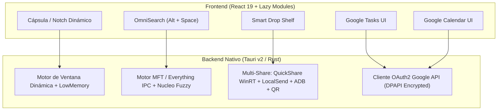

# 🚀 Plan de Implementación — Crest "Santi Edition" (`crest-dev`)

> **Proyecto base:** Crest v1.1.0 (`Tauri v2` + `Rust` + `React 19` + `TypeScript` + `Vite`)  
> **Ubicación del repositorio:** `C:\Users\Santi\Documents\crest-dev`  
> **Versión limpia de referencia:** `C:\Users\Santi\AppData\Local\Programs\Crest\Crest\Crest.exe`  
> **Objetivo:** Transformar Crest en un centro de comando ultra-ligero (<75 MB de RAM en reposo, 0% CPU ocioso) con buscador instantáneo estilo Flow Launcher (`Alt + Space` sobre el índice MFT de Windows), envío inmediato entre dispositivos (Quick Share / LocalSend / ADB / Telegram / QR bidireccional) y sincronización bidireccional nativa con **Google Tasks** y **Google Calendar**.

---

## 🏗️ Arquitectura General de los Cambios



---

## ⚡ FASE 1: Optimización Extrema de Rendimiento ("Ultra-Light Engine")

**Diagnóstico actual:** La versión original consume **~292 MB de RAM privada** (~480 MB Working Set) porque:
1. La ventana transparente mide permanentemente `760×560 px` aunque el notch esté cerrado (`200×32 px`), obligando al proceso `msedgewebview2.exe --type=gpu-process` a mantener un framebuffer de DirectComposition de **~142 MB**.
2. En `src/main.tsx` (líneas 43–64) se inician **22 bucles de polling** simultáneos al arrancar.
3. En `src/notch/tabs.tsx` se importan de forma ansiosa (*eager*) las ~30 herramientas (incluyendo `@xterm/xterm`) dentro de un único bundle de JavaScript.

### 1.1. Viewport Dinámico a Nivel de Sistema (`src-tauri/src/display.rs` y `tauri.conf.json`)
* **Cambio:** Cuando el notch está en estado `closed` o `line`, ajustar el tamaño real del `HWND` nativo de Windows al bounding box estricto de la cápsula cerrada (`300×44 px`) y redimensionarlo a `760×560 px` únicamente en el instante previo a expandir el panel (`status === "open"` o al presionar `Alt + Space`).
* **Impacto estimado:** Reducción inmediata de **~95 MB a ~110 MB de RAM/VRAM** en el proceso GPU de WebView2.

### 1.2. Poda Quirúrgica de Demonios y Dependencias ("De-Bloat")
* **En `src/main.tsx` y `src-tauri/src/lib.rs`:**
  * Desactivar y remover del arranque los *pollers* que no aportan a tu flujo: `startDiscord()`, `startGithub()`, `startUsagePolling()` (tokens AI), `startWaterReminders()`, `startBreaks()`, `startGamingWatch()`, `trading::TradingState`, `terminal::TerminalState`.
  * Remover `@xterm/xterm` y `@xterm/addon-fit` de `package.json`.
* **Impacto estimado:** **0.0% de uso de CPU en reposo** (sin timers despertando el hilo de V8 cada pocos segundos).

### 1.3. Carga Diferida (`React.lazy` + Code Splitting) en `src/notch/tabs.tsx`
* **Cambio:** Convertir todas las vistas de herramientas (`CalendarView`, `TodoView`, `ShelfView`, `SettingsView`, etc.) en imports dinámicos con `React.lazy(() => import(...))`.
* **Impacto:** Al iniciar Windows, WebView2 solo parsea y compila el código de la cápsula cerrada y el buscador `Alt + Space`. La memoria del proceso `renderer` baja de **~123 MB a ~35 MB**.

### 1.4. Flags de Bajo Consumo para WebView2 (`src-tauri/tauri.conf.json`)
* **Cambio en `additionalBrowserArgs`:**
  ```text
  --disable-features=msWebOOUI,msPdfOOUI,msSmartScreenProtection,Translate,msEdgeTranslate,SpareRendererForSitePerProcess,OptimizationHints,MediaRouter,AutofillServerCommunication,AudioServiceOutOfProcess
  --skia-resource-cache-limit-mb=16
  --skia-font-cache-limit-mb=4
  --disable-gpu-shader-disk-cache
  --renderer-process-limit=1
  --js-flags="--lite-mode --optimize-for-size"
  ```
* **Hibernación agresiva (`src/notch/Notch.tsx` línea 58):**
  * Reducir `MEMORY_LOW_AFTER_MS` de `20_000` (20 s) a `2_500` (2.5 s) para que `SetMemoryUsageTargetLevel(COREWEBVIEW2_MEMORY_USAGE_TARGET_LEVEL_LOW)` en `src-tauri/src/memory.rs` purgue las cachés de V8 apenas cerrás el notch.

### 📊 Meta de Rendimiento Post-Fase 1
| Métrica | Crest Original | Crest "Santi Edition" (Meta) |
| :--- | :--- | :--- |
| **RAM Privada Total (Reposo)** | ~292 MB | **45 – 75 MB** |
| **CPU en Reposo** | 0.2% – 0.8% (22 pollers) | **0.00%** (Event-driven puro) |
| **Latencia de Apertura (`Alt + Space`)** | N/A | **< 8 ms** |

---

## 🔍 FASE 2: Modo "OmniSearch" (`Alt + Space`) — Reemplazo Definitivo de Flow Launcher

El objetivo es que al presionar **`Alt + Space`** en cualquier momento (incluso dentro de otra aplicación), el notch se despliegue instantáneamente como una barra de comando y búsqueda ultra-rápida.

### 2.1. Arquitectura del Motor de Búsqueda en Rust (`src-tauri/src/omnisearch.rs`)
Para lograr **el algoritmo de búsqueda más rápido que existe en una PC con Windows**, combinaremos tres motores en Rust:

1. **Búsqueda Instantánea de Archivos vía NTFS MFT / Everything SDK:**
   * En lugar de recorrer carpetas con `ReadDirectoryChangesW` o `walkdir`, el módulo en Rust se conecta por memoria compartida / IPC con el motor de **Everything** (o indexa directamente la tabla MFT de NTFS).
   * Permite buscar entre **más de 1.000.000 de archivos en ~1.5 milisegundos**.
2. **Fuzzy Matching Paralelo con `nucleo-matcher` (Rust):**
   * Integramos el crate `nucleo-matcher` (el algoritmo escrito en Rust para el editor *Helix*, sustancialmente más rápido que `fzf` o `skim`).
   * Indexa en RAM al iniciar:
     * Todos los accesos directos de aplicaciones (`%ProgramData%\Microsoft\Windows\Start Menu\Programs` y `%AppData%\Microsoft\Windows\Start Menu\Programs`).
     * Tus carpetas clave (`Documents\Facultad`, `Documents\Vault`, proyectos de código).
   * Tolerante a errores de tipeo: escribir `elctrdig` encuentra inmediatamente `Electrónica Digital`.
3. **Búsqueda Interior en tus PDFs de la Facultad (Integración SQLite FTS5):**
   * Conexión directa en solo-lectura con la base SQLite FTS5 de tu índice local de PDFs (`pdf-indice-local`), permitiendo buscar conceptos dentro de tus libros (Patton, Saladin, apuntes de Control o Digital) directamente desde el notch y abrir el PDF en la página exacta.

### 2.2. Modos y Prefijos Inteligentes en la Barra `Alt + Space`
* **Sin prefijo (Búsqueda Universal):** Aplicaciones instaladas + Archivos prioritarios (`Facultad`, `Vault`, `Documentos`) + Cálculos rápidos.
* **Matemática e Ingeniería en Vivo:**
  * Si escribís una expresión como `1 / (2 * pi * 10e3 * 100e-9)` o `20 * log10(45)`, calcula el resultado en tiempo real (ideal para frecuencia de corte $f_c$, ganancias en dB, divisores resistivos o conversiones hex/binario `0xFF -> bin` para Electrónica Digital).
* **Prefijo `t ` (Google Tasks rápido):**
  * Ej: `t Estudiar unidad 10 de Timer mañana 16:00` → Crea la tarea directamente en tu Google Tasks sin cambiar de ventana.
* **Prefijo `c ` (Google Calendar rápido):**
  * Ej: `c Parcial Electromedicina viernes 14:00 a 16:00` → Agenda el evento en tu Google Calendar.
* **Prefijo `p ` (Buscar adentro de tus PDFs):**
  * Ej: `p potencial de acción` → Muestra en qué libro/apunte y página aparece y lo abre con 1 Enter.
* **Acciones con Teclado sobre cualquier Resultado:**
  * `Enter`: Abrir archivo / aplicación.
  * `Ctrl + Enter`: Mostrar archivo en el Explorador de Windows (`reveal_file`).
  * `Shift + Enter`: Mandar el archivo directamente al *Shelf* o enviarlo al celular/tablet.
  * `Tab`: Autocompletar o ver acciones secundarias.

---

## 📱 FASE 3: Smart Drop Shelf y Envío Ultra-Rápido entre Dispositivos

Al arrastrar uno o varios archivos (o pegar con `Ctrl + V` texto/capturas) hacia la isla superior, el módulo `src/features/shelf/ShelfView.tsx` y el backend `src-tauri/src/quick_send.rs` ofrecerán **4 vías de transferencia inmediata** hacia tu celular o tablet:

### 3.1. Vía 1: Windows Quick Share / Diálogo Nativo WinRT (`ShowShareUIForWindow`)
* **Cómo funciona:** En `src-tauri/src/quick_send.rs` invocaremos la API nativa de Windows 11 (`IDataTransferManagerInterop::ShowShareUIForWindow`) y/o el cliente de **Quick Share de Google para Windows**.
* **Ventaja:** Con un solo clic en el botón **"Quick Share"** del notch, se dispara el envío directo por Wi-Fi Direct / Bluetooth a tu teléfono o tablet Android con velocidades de 40–80 MB/s.

### 3.2. Vía 2: Protocolo LocalSend Nativo Integrado en el Notch
* **Cómo funciona:** Implementaremos el protocolo abierto de **LocalSend** (descubrimiento por UDP Multicast en `224.0.0.167:53317` + transferencia HTTP/TLS local) directamente en Rust.
* **Ventaja:** Si tenés la app gratuita LocalSend abierta en el celu o en la tablet, **sus íconos aparecen directamente dentro del notch** cuando arrastrás un archivo. Soltás el archivo encima del ícono *"Tablet de Santi"* o *"Celu"* y se transfiere al instante sin tocar ningún menú intermedio.

### 3.3. Vía 3: ADB Push de 1 Clic (Cable o Wi-Fi Debugging)
* **Cómo funciona:** Aprovechando que tenés `adb` instalado en la PC, el backend detecta dispositivos conectados (`adb devices`).
* **Ventaja:** Botón **"ADB -> Descargas"** que ejecuta `adb push <archivo> /sdcard/Download/` en segundo plano y muestra una barra de progreso en la píldora del notch. No requiere siquiera desbloquear la pantalla del celular o la tablet.

### 3.4. Vía 4: Servidor QR Bidireccional Mejorado (`src-tauri/src/phone_share.rs`) + Puente a Telegram
* **Mejora sobre el QR actual de Crest:**
  * Hoy `phone_share.rs` solo sirve archivos de PC → Celular. Le agregaremos un endpoint `POST /upload` en el mismo servidor local para que también sea **Celular → PC**: escaneás el QR desde el celu, seleccionás las fotos del pizarrón que sacaste en clase y caen directo en tu carpeta `Facultad` o en el *Shelf* del notch.
* **Botón "Mandar a mi Telegram":**
  * Envía el archivo o nota rápida directamente a tus *Mensajes Guardados* de Telegram para que te quede disponible en todos tus dispositivos aún cuando no estés en la misma red Wi-Fi.

---

## 📅 FASE 4: Integración Bidireccional con Google Tasks y Google Calendar

Actualmente, Crest guarda los *To-Dos* solo en `localStorage` (`src/features/todos/store.ts`) y lee calendarios únicamente de forma pasiva por links ICS/CalDAV (`src-tauri/src/calendar.rs`). Vamos a reemplazar ambos motores por una sincronización nativa y bidireccional con tus cuentas de Google.

### 4.1. Módulo de Autenticación y Seguridad (`src-tauri/src/google_sync.rs`)
* **Almacenamiento seguro:** El token OAuth2 (`access_token` + `refresh_token`) se guardará cifrado mediante **Windows DPAPI** a través de `src-tauri/src/secrets.rs` en `%APPDATA%\io.github.andrealo20.crest\`, **sin tocar ni modificar absolutamente nada de tu carpeta `Vault`**.
* **Renovación automática:** El cliente Rust en `google_sync.rs` renovará el `access_token` automáticamente en segundo plano antes de que expire.
* **Caché Offline-First:** Tanto las tareas como los eventos se persisten localmente en JSON (`gtasks-cache.json` y `gcal-cache.json`). Al abrir el notch, la UI muestra tus datos en **0 ms** desde la caché y sincroniza deltas en segundo plano (*Optimistic UI*).

### 4.2. Google Tasks Nativo en el Notch (`src/features/todos/`)
* **Mapeo 1:1 con tus listas reales:**
  * Las listas de tu cuenta de Google Tasks (ej. *"Facultad"*, *"Mis tareas"*, etc.) aparecerán como las pestañas de proyectos en la vista *To-Do* de Crest.
* **Operaciones Bidireccionales Soportadas (API `tasks/v1`):**
  * **Listar tareas y subtareas** con sus fechas de vencimiento (`due`) y notas (`notes`).
  * **Crear tarea** desde el notch o desde el atajo `Alt + Space` (`tasks.insert`).
  * **Completar / Desmarcar tarea** (`tasks.patch` con `status: "completed"` / `"needsAction"`), sincronizando al instante con el widget de tu celular.
  * **Editar título, fecha de entrega o mover de lista.**

### 4.3. Google Calendar Bidireccional (`src/features/calendar/` y `src-tauri/src/calendar.rs`)
* **Operaciones Bidireccionales Soportadas (API `calendar/v3`):**
  * **Lectura multi-calendario:** Trae todos tus calendarios activos de Google con sus colores originales (`colorId` / `backgroundColor`), horarios, ubicaciones y links de videollamada (`hangoutLink` / Google Meet).
  * **Píldora Inteligente en el Notch Cerrado:**
    * Muestra cuánto falta para tu próxima clase, entrega o evento (ej. *"Control Básico en 15 min"*).
    * Si tiene link de Meet/Zoom, muestra un botón directo para entrar con 1 clic.
  * **Creación y Edición Rápida de Eventos:**
    * Formulario rápido en la vista de Calendario del notch + comando rápido en `Alt + Space` para agendar parciales, entregas o bloques de estudio sin abrir el navegador.

---

## 🧠 FASE 5: Funcionalidades Extra Pensadas para tu Flujo (Bioingeniería + Estudio)

Aprovechando que tenemos control total del código en `crest-dev`, sumaremos 3 utilidades de altísimo impacto y costo cero en RAM:

1. **Modo "Pomodoro Académico" vinculado a Google Tasks:**
   * En la pestaña Timer de Crest, podrás elegir una tarea pendiente de tu lista *"Facultad"* de Google Tasks antes de darle *Play* al Pomodoro.
   * Mientras corre el Pomodoro, la píldora cerrada muestra el nombre de la tarea y el contador, silencia alertas no urgentes y al terminar el bloque te permite marcar la tarea como completada en Google Tasks con un clic.
2. **OCR Matemático y de Texto Instantáneo (`Win + Shift + O` o desde el Notch):**
   * Seleccionás un área de la pantalla (un PDF escaneado, un gráfico o un video de YouTube de una clase):
   * Si es texto normal, usa la API `Windows.Media.Ocr` nativa (en 50 ms, offline) y lo copia al portapapeles o al *Shelf*.
   * Si es una tabla o circuito, te permite mandarlo directo al *Shelf* o a tu carpeta de trabajo.
3. **Detector Inteligente en el Portapapeles y Shelf:**
   * Si copiás una ruta de archivo, un color HEX (`#1A2B3C`), una expresión matemática o un comando, el notch te ofrece la acción contextual inmediata (ej. abrir ruta, convertir color, copiar resultado).

---

## 🗓️ Hoja de Ruta de Ejecución (Sprints)

Para mantener el proyecto ordenado y que puedas probar cada mejora de forma incremental:

* **Sprint 1 — Entorno y "Ultra-Light Engine" (Rendimiento):**
  * Instalar toolchain de Rust (`rustup`) si hace falta para compilar `src-tauri`.
  * Aplicar la poda de los 22 *pollers* en `src/main.tsx` y `src-tauri/src/lib.rs`.
  * Implementar `React.lazy()` en `src/notch/tabs.tsx`, viewport dinámico y flags de memoria de WebView2.
  * *Entregable:* Binario compilado consumiendo ~50–75 MB de RAM en reposo.
* **Sprint 2 — OmniSearch (`Alt + Space`):**
  * Crear `src-tauri/src/omnisearch.rs` con indexador de aplicaciones + integración MFT/Everything + `nucleo-matcher` + calculadora de ingeniería.
  * Crear la interfaz `src/features/omnisearch/OmniSearchView.tsx` activada con `Alt + Space`.
* **Sprint 3 — Google Tasks & Google Calendar Bidireccional:**
  * Crear `src-tauri/src/google_sync.rs` con OAuth2 + DPAPI.
  * Conectar `src/features/todos/store.ts` a Google Tasks API v1 y `src/features/calendar/store.ts` a Google Calendar API v3.
* **Sprint 4 — Multi-Share en el Shelf (Quick Share + LocalSend + ADB + QR Bidireccional):**
  * Expandir `src-tauri/src/phone_share.rs` con subida bidireccional Celu → PC.
  * Agregar invocación de Windows Share / Quick Share, ADB Push en 1 clic y descubrimiento LocalSend en `src/features/shelf/ShelfView.tsx`.
* **Sprint 5 — Herramientas Académicas (Pomodoro + Tasks & OCR Rápido):**
  * Vincular el Timer con las tareas de Google Tasks y pulir detalles visuales.
